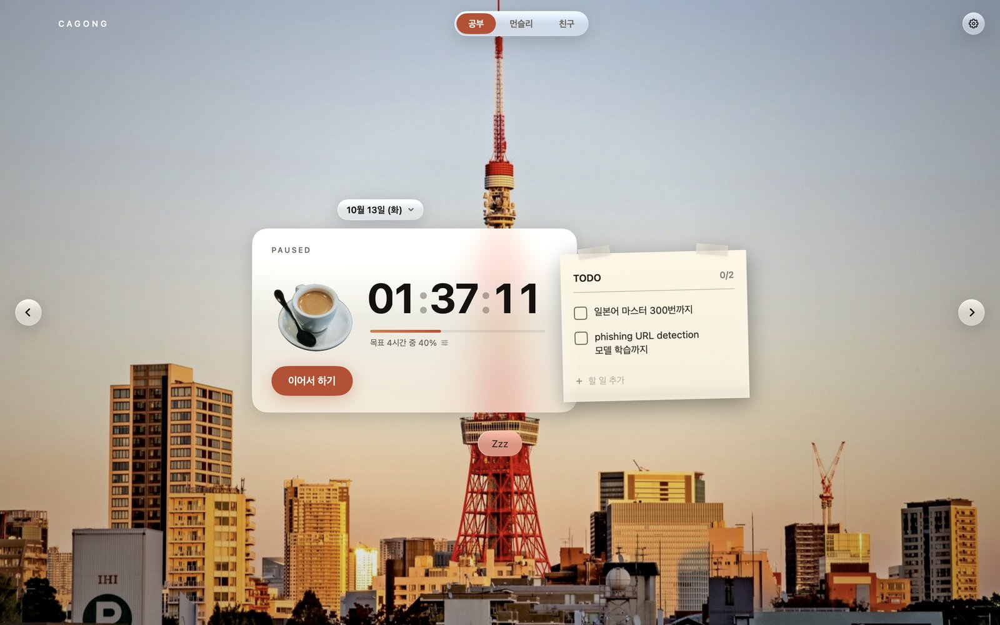
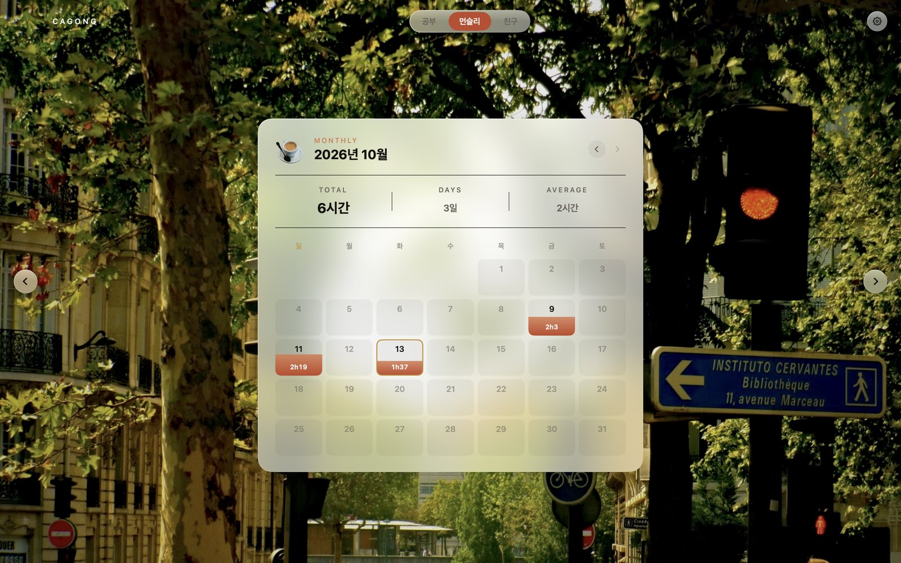
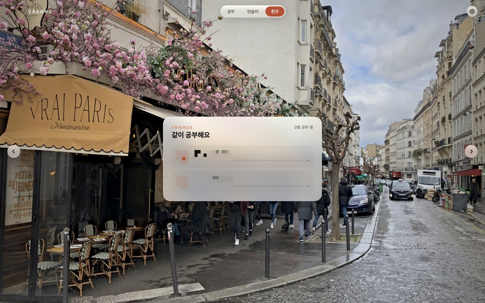

<p align="right">
<a href="README.md"></a> <a href="README.ko.md"></a>
</p>

# ☕ CAGONG

**카페 창가 자리에서 공부하는 기분이 드는 macOS 공부 타이머입니다.**

도쿄의 노을, 파리의 길모퉁이, 센강의 밤. 좋아하는 풍경을 배경으로 띄우고 좋아하는 음료를 한 잔 올려 둔 뒤,
오늘 할 일을 적고 '시작'만 누르면 됩니다. 공부한 시간은 월간 캘린더에 쌓이고, 친구가 지금 공부 중인지도
볼 수 있습니다.



## 할 수 있는 것

### ⏱ 열고, 누르기만

앱을 열면 날짜는 이미 오늘로 맞춰져 있습니다. TODO를 적고 시작을 누르면 측정이 시작됩니다.

- **하루 목표** — `목표 4시간 중 40%` 표시를 누르면 그날의 목표를 바꿀 수 있습니다. 시험 전과 주말의 목표가 같을 필요는 없으니까요
- **메모지 TODO** — 매일 하는 일은 압정으로 고정해 두면 다음 날에도 처음부터 올라와 있습니다
- **자정을 넘겨도 괜찮아요** — 밤에 시작해 새벽 2시까지 이어 가도, 시간은 전부 시작한 날에 들어갑니다
- **닫아도 이어서** — 앱을 닫았다 다시 열어도 측정 화면으로 돌아옵니다(닫혀 있던 동안의 시간은 세지 않습니다)

### 📅 한 달을 한눈에



날짜 칸에는 그날 공부한 시간이 들어가고, 목표 대비 달성도만큼 칸이 아래에서부터 채워집니다.
위에는 이달의 합계, 공부한 날 수, 하루 평균이 나옵니다. 날짜를 누르면 **몇 시에 앉아서 몇 시에 마무리했는지**와
그날의 TODO까지 돌아볼 수 있습니다.

### 👥 친구와 함께



초대 코드로 친구를 추가하고, 상대가 수락하면 서로 친구가 됩니다. 친구가 지금 공부 중인지, 오늘 얼마나 했는지가
한눈에 보입니다. 친구가 공부를 시작했을 때, 목표의 절반이나 전부를 채웠을 때, 그날 공부를 마쳤을 때 알림이 옵니다.
(이미지 속 친구 이름은 흐리게 처리했습니다)

### 🎨 원하는 분위기로

- **테마 3종** — 실제 카페 사진을 배경으로 쓰는 `사진 카페`, 크라프트지와 에스프레소의 `웜 카페`,
  스탠드 하나만 켠 `심야 스탠드`
- **배경 사진** — 파리의 여름, 몽마르트 카페, 도쿄 노을, 센강의 밤. `⌘←` `⌘→`로 바꿀 수 있고, 내 사진도 추가할 수 있습니다
- **음료 6종** — Espresso, Americano, Cafe Latte, Matcha Latte, Lemonade, Chocolate Frappuccino.
  측정 중에는 따뜻한 음료에서 김이 올라와서, 숫자를 보지 않아도 상태를 알 수 있습니다

## 공들인 부분

**클릭을 한 번도 놓치지 않게**
저장은 백그라운드 큐에서 하고, 메인 스레드는 값을 복사해 넘기기만 하도록 바꿨습니다.
클릭 한 번당 처리 시간이 9.5ms에서 0.04ms로 줄어, 기록이 3년 치 쌓여도 한 프레임(16.6ms)을 넘지 않습니다.
측정 중 화면 전체의 재렌더링도 초당 3회에서 0회로 줄였습니다.

**누른 곳이 제대로 눌리게**
SwiftUI는 그려진 부분만 클릭 영역으로 보기 때문에, 화살표 버튼에서 실제로 눌리는 곳은 보이는 면적의 7%뿐이었습니다.
공용 버튼 스타일 3개에 `contentShape`를 걸어 앱의 모든 버튼을 한 번에 고쳤습니다.

**기록이 사라지지 않게**
사용자의 조작은 바로 디스크에 쓰고, 일시정지·종료·다른 앱으로 전환할 때는 동기로 확실히 저장합니다.
날짜 귀속, 저장 시점, 옛 형식 이전 등은 동작 검증 81건(`Tools/StoreTest.swift`)으로 확인합니다.

## 시작하기

```bash
./build.sh --run
```

`build/CAGONG.app`이 만들어지고 실행됩니다. Command Line Tools만 있으면 되고, Xcode는 필요 없습니다.
Xcode를 쓴다면 `Package.swift`를 열고 ⌘R로 실행할 수 있습니다.

## 동작 환경 · 기술 스택

| | |
|---|---|
| 동작 환경 | macOS 14 이상 (앱 표시 언어는 한국어) |
| 언어 · UI | Swift, SwiftUI |
| 빌드 | Swift Package Manager, `build.sh` |
| 저장 | 로컬 JSON (`~/Library/Application Support/Cagong/`) |
| 친구 기능 | Supabase |

사진의 출처와 라이선스는 [CREDITS.md](CREDITS.md)에 있습니다.
